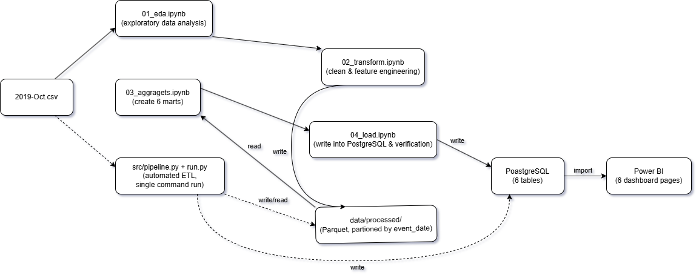
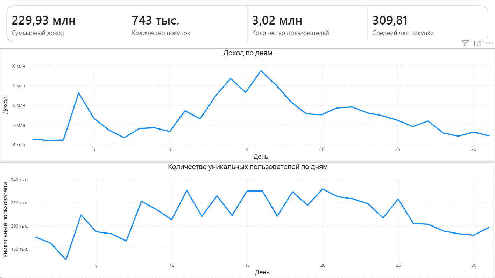
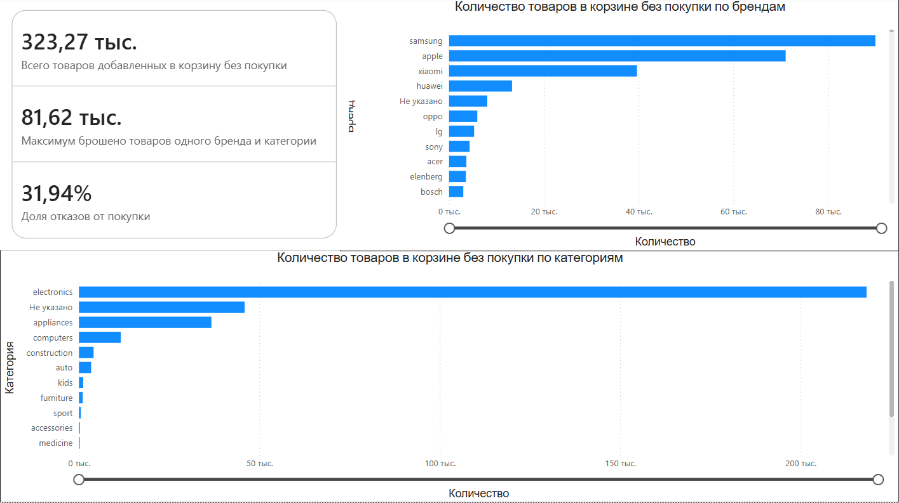
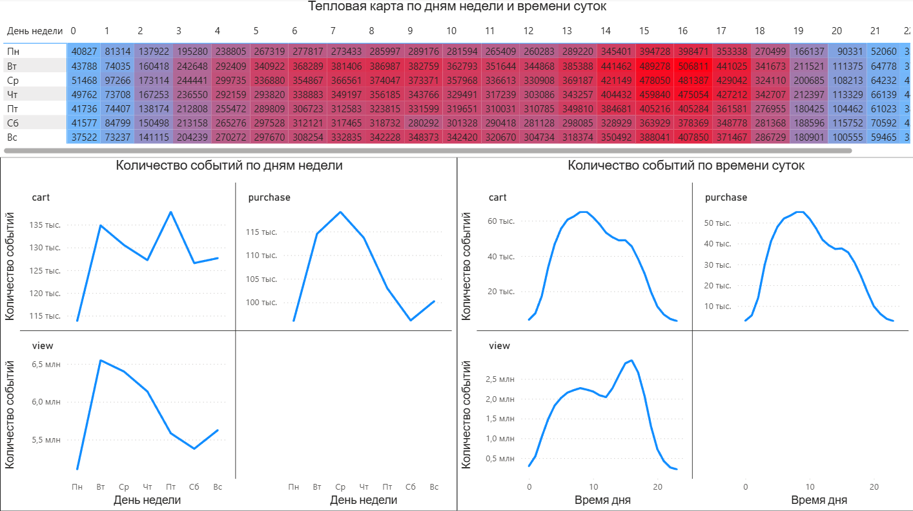

# eCommerce Behavior Analysis

Продуктовый анализ поведения пользователей интернет-магазина на основе публичного датасета [eCommerce behavior data from multi category store](https://www.kaggle.com/datasets/mkechinov/ecommerce-behavior-data-from-multi-category-store) (файл `2019-Oct.csv`, ~42.4M событий).

## Архитектура



Сырые данные обрабатываются в Spark, витрины загружаются в PostgreSQL, Power BI подключается к базе. Все окружение контейнеризировано в Docker.

## Что реализовано

- **`01_eda.ipynb`** — разведочный анализ: качество данных и проверка гипотез о том, как устроены данные
- **`02_transform.ipynb`** — очистка на основе выводов EDA
- **`03_aggregates.ipynb`** — создание шести витрин с помощью Spark SQL
- **`04_load_to_postgres.ipynb`** — запись витрин в PostgreSQL + проверка целостности
- **`pipeline.py` + `run.py`** — вся логика (02-04) в виде функций, весь пайплайн можно перезапустить одной командой
- **`dashboard.pbix`** — дашборд на 6 страниц, по одной на витрину

## Витрины и дашборд

### Overview — `daily_summary`
Сводные KPI по дням: выручка, пользователи, покупки, средний чек.



### Funnel — `funnel_daily`
Объём событий (view/cart/purchase) по дням. Несмотря на название, это **не строгая последовательная воронка**.


### Sales by Category — `category_sales`
Выручка, количество покупок, средняя и медианная цена по категориям и брендам.


### Cart Abandonment — `cart_abandonment`
Товары, добавленные в корзину, но не купленные.



### Time Patterns — `time_patterns`
Активность пользователей по дням недели и времени суток.



### Users — `user_metrics`
Сессии, покупки, траты и давность последней активности на пользователя.


## Ключевые инсайты

- **53–56% покупок совершаются без предварительного добавления товара в корзину.**
- **Только ~11.5% пользователей за месяц совершили хотя бы одну покупку.** При этом среднее число сессий на пользователя — 3.06, а среднее число покупок — 0.25: подавляющее большинство трафика не конвертируется вовсе.
- **Распределение цены товара сильно скошено вправо** (медиана 162 при 99.9-м перцентиле 2574). Среднее и медиана в дашборде показаны рядом — там, где они заметно расходятся, виден вклад немногочисленных дорогих товаров.
- **electronics/smartphone — доминирующая категория по выручке** (176 млн из 230 млн общей выручки приходится на electronics, из них 157 млн — на smartphone).
- **Активность заметно проседает в выходные** — и по объёму событий, и по числу покупок, при этом дневной пик активности стабилен (14:00–18:00) независимо от дня недели.

## Структура проекта

```
├── data/
│   ├── raw/
│   └── processed/
├── docs/
│   ├── architecture.png
│   ├── Cart_Abandonment.png
│   ├── Funnel.png
│   ├── Overview.png
│   ├── Sales_by_Category.png
│   ├── Time_Patterns.png
│   └── Users.png
├── notebooks/
│   ├── 01_eda.ipynb
│   ├── 02_transform.ipynb
│   ├── 03_aggregates.ipynb
│   └── 04_load_to_postgres.ipynb
├── powerbi/
│   └── ecommerce_dashboard.pbix
├── src/
│   ├── pipeline.py
│   └── run.py
├── utils/
│   ├── config.py
│   ├── schema.py
│   └── spark_session.py
├── docker-compose.yml
└── README.md
```

## Стек

- **Apache Spark / Spark SQL** (PySpark) — обработка и агрегации
- **PostgreSQL** — хранение готовых витрин
- **Power BI** — визуализация
- **Docker** — контейнеризация окружения
- **Jupyter** — среда разработки пайплайна