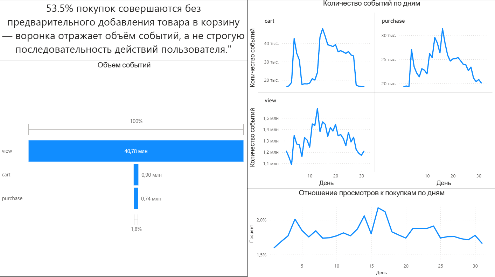
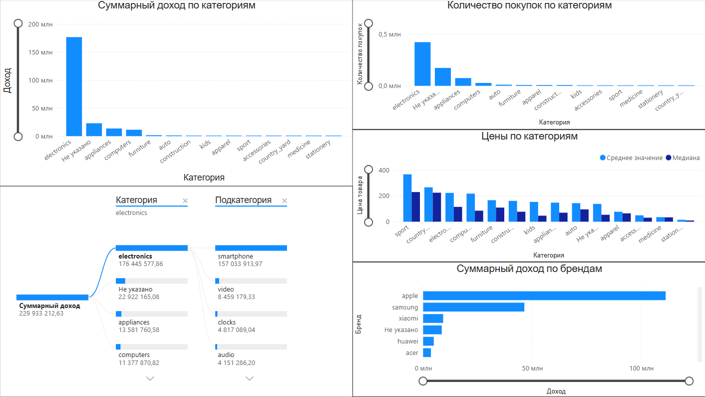
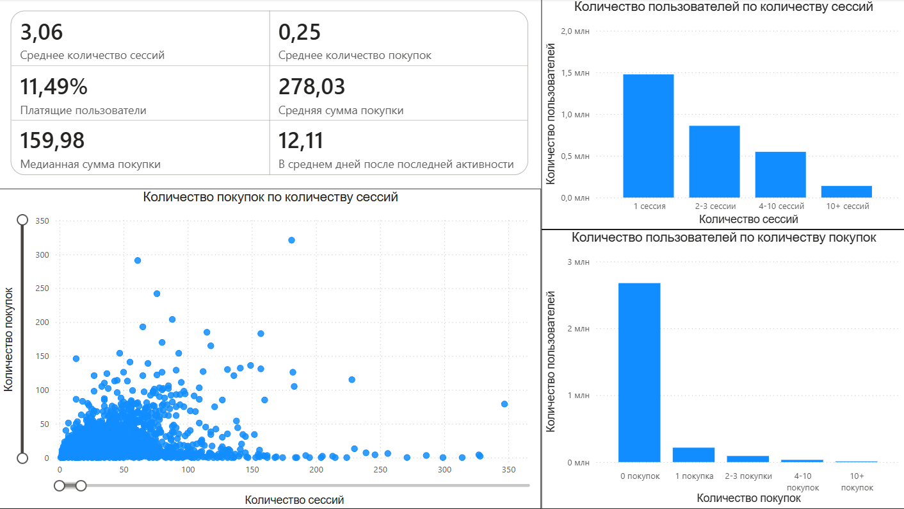

# eCommerce Behavior Analysis

Продуктовый анализ поведения пользователей интернет-магазина на основе публичного датасета [eCommerce behavior data from multi category store](https://www.kaggle.com/datasets/mkechinov/ecommerce-behavior-data-from-multi-category-store) (файл `2019-Oct.csv`, ~42.4M событий).

**Цель проекта** — исследовать пользовательскую активность и покупки, выявить особенности поведения пользователей, подготовить аналитические витрины и представить результаты в виде дашборда.


## Ключевые инсайты

- **53–56% покупок** совершаются без предварительного добавления товара в корзину.
- Около **11.5% пользователей** за рассматриваемый месяц совершили хотя бы одну покупку. Среднее число сессий на пользователя — **3.06**, среднее число покупок — **0.25**.
- Распределение цен сильно скошено вправо: медиана составляет **162**, а 99,9-й перцентиль — **2574**. Поэтому при анализе цен полезно рассматривать среднее и медиану вместе.
- Категория **electronics** формирует основную часть выручки: **176 млн из 230 млн**. На смартфоны приходится **157 млн**.
- Активность заметно снижается в выходные — как по объёму событий, так и по количеству покупок. Дневной пик активности приходится на **14:00–18:00** независимо от дня недели.

## Дашборда

Дашборд состоит из шести страниц и позволяет изучать общие показатели, покупки, категории товаров, активность и пользовательские метрики.

### Overview


<details>
<summary>Остальные страницы</summary>

### Funnel



### Sales by Category



### Cart Abandonment


### Time Patterns


### Users


</details>

## Аналитические витрины

Для анализа подготовлено шесть витрин. Они загружаются в PostgreSQL и используются в Power BI.

| Страница дашборда | Витрина | Содержание |
|---|---|---|
| Overview | `daily_summary` | Ежедневные KPI: выручка, пользователи, покупки и средний чек |
| Funnel | `funnel_daily` | Количество событий `view`, `cart` и `purchase` по дням |
| Sales by Category | `category_sales` | Выручка, количество покупок, средняя и медианная цена по категориям и брендам |
| Cart Abandonment | `cart_abandonment` | Товары, добавленные в корзину, но не купленные |
| Time Patterns | `time_patterns` | Активность пользователей по дням недели и времени суток |
| Users | `user_metrics` | Сессии, покупки, траты и давность последней активности на пользователя |

> **Важно:** `funnel_daily` показывает динамику количества событий. Это не последовательная пользовательская воронка и по ней нельзя напрямую оценить переходы пользователей между этапами, так как `cart` не является обязательным промежуточным событием между `view` и `purchase`.

## Архитектура проекта


### Этапы работы

- **Исследовательский анализ** (`01_eda.ipynb`) — Изучение структуры исходных данных, оценка качества и проверка гипотез о данных.
- **Очистка и преобразование** (`02_transform.ipynb`) — Подготовка данных на основе результатов EDA.
- **Построение витрин** (`03_aggregates.ipynb`) — Создание шести аналитических витрин с использованием Spark SQL.
- **Загрузка в PostgreSQL** (`04_load_to_postgres.ipynb`) — Запись витрин в базу данных и проверка целостности загруженных данных.
- **Автоматизация** (`pipeline.py` + `run.py`) — Логика этапов очистки, агрегации и загрузки вынесена в функции. Процесс воспроизводится одной командой.

## Структура проекта

```
├── data/
│   ├── raw/
│   └── processed/
├── docs/
│   ├── architecture.png
│   ├── Cart_Abandonment.png
│   ├── Funnel.png
│   ├── Overview.png
│   ├── Sales_by_Category.png
│   ├── Time_Patterns.png
│   └── Users.png
├── notebooks/
│   ├── 01_eda.ipynb
│   ├── 02_transform.ipynb
│   ├── 03_aggregates.ipynb
│   └── 04_load_to_postgres.ipynb
├── powerbi/
│   └── ecommerce_dashboard.pbix
├── src/
│   ├── pipeline.py
│   └── run.py
├── utils/
│   ├── config.py
│   ├── schema.py
│   └── spark_session.py
├── docker-compose.yml
├── requirements.txt
└── README.md
```

## Стек технологий

- **Python** - Обработка данных и реализация пайплайна.
- **Apache Spark / Spark SQL** — Очистка, преобразование и агрегация данных.
- **PostgreSQL** — Хранение подготовленных аналитических витрин.
- **Power BI** — Визуализация показателей и результатов анализа.
- **Docker** — Контейнеризация окружения
- **Jupyter Notebook** — Исследовательский анализ и разработка этапов обработки.